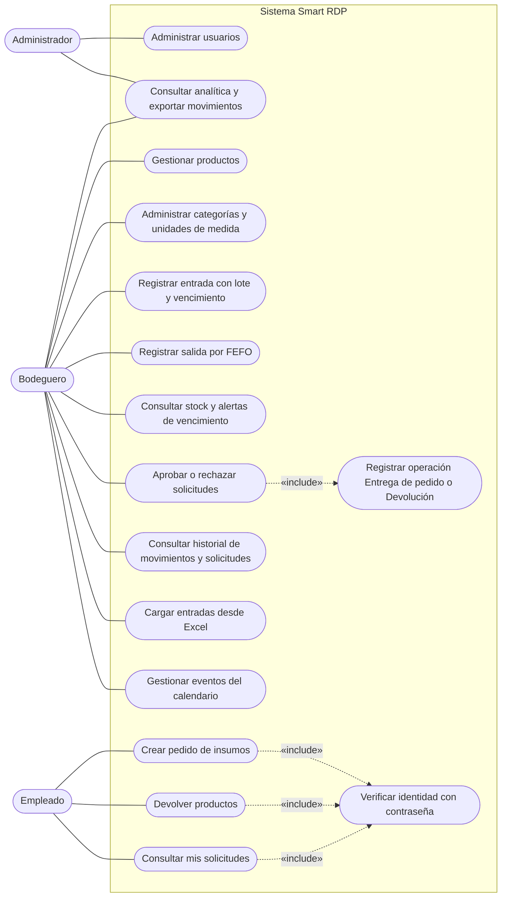
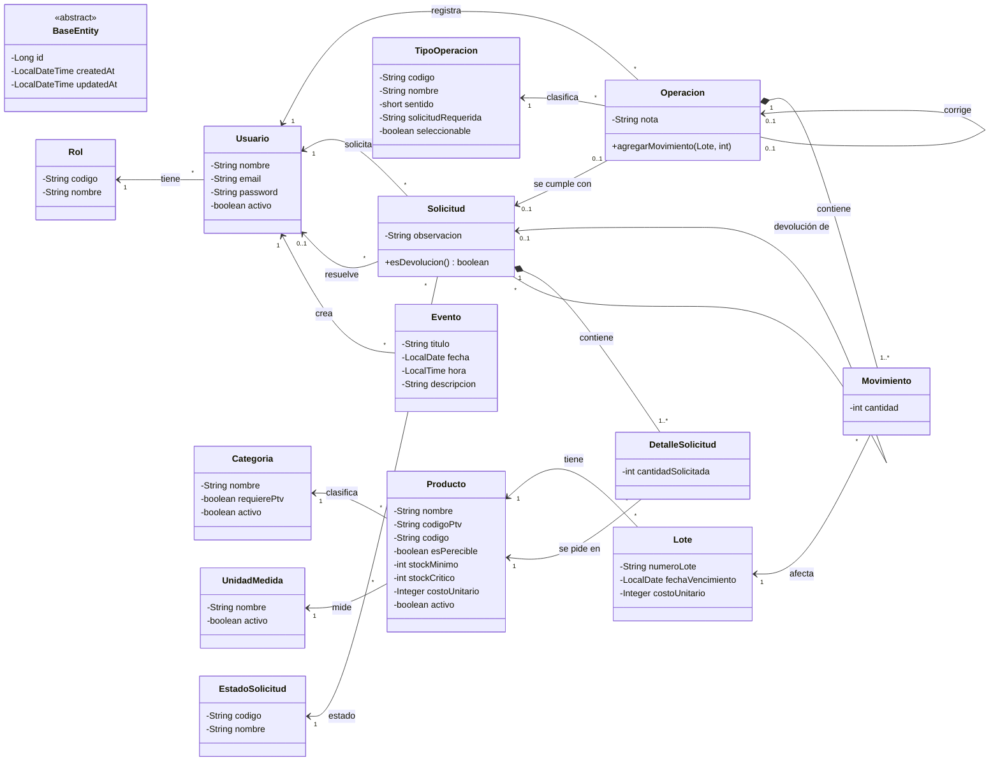
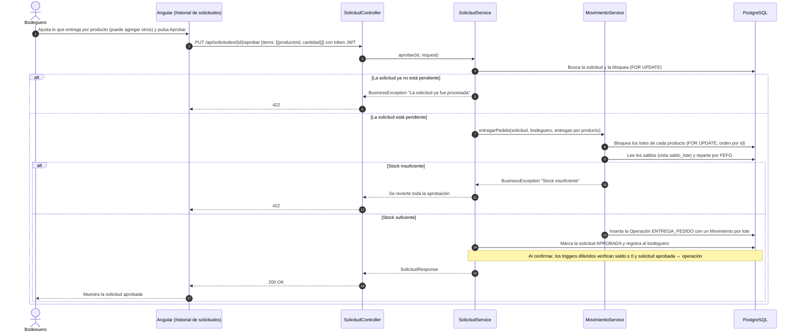
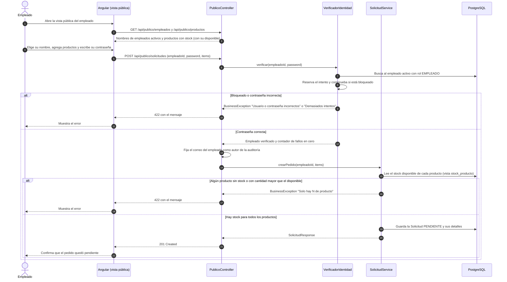
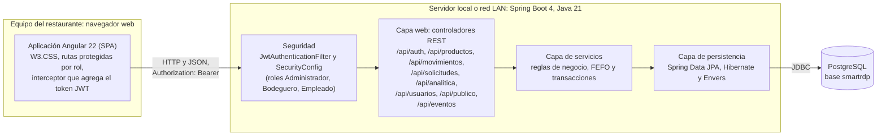
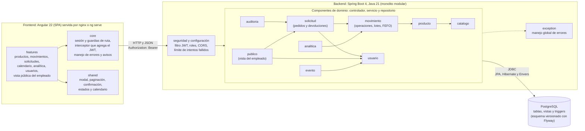

# Diagramas UML — Smart RDP

> Proyecto de Título PTY4614-002D · Equipo 3 · Duoc UC, Sede San Bernardo
> Versión: borrador para revisión · 13-11-2026 (se agregó el diagrama de componentes)

## 1. Alcance

El proyecto documenta seis diagramas UML, suficientes para describir qué hace el sistema, cómo se estructura y cómo se ejecutan sus dos flujos principales. Cubren cinco de los 14 tipos de diagrama de UML 2.5.1 (casos de uso, clases, secuencia, componentes y despliegue) y se complementan con el [modelo de datos](../EVIDENCIAS%20DE%20SISTEMA/BASE%20DE%20DATOS/07-MODELO-DE-DATOS.md).

| N.º | Diagrama | Tipo UML | Qué muestra |
|---|---|---|---|
| 1 | Casos de uso | Comportamiento | Qué puede hacer cada rol. |
| 2 | Clases del dominio | Estructura | Entidades de negocio y sus relaciones. |
| 3 | Aprobar un pedido | Interacción (secuencia) | Cómo el bodeguero aprueba y se descuenta el stock por FEFO. |
| 4 | Pedido del empleado | Interacción (secuencia) | Cómo el empleado se identifica y crea un pedido. |
| 5 | Arquitectura y despliegue | Estructura (despliegue, dibujado como diagrama de flujo) | Capas del sistema y dónde corren. |
| 6 | Componentes | Estructura (componentes, dibujado como diagrama de flujo) | Módulos del frontend y del backend, sus dependencias y las interfaces entre ellos. |

Los diagramas están escritos en [Mermaid](https://mermaid.js.org), que GitHub dibuja directamente en el navegador. El diagrama de casos de uso se dibuja con la sintaxis de diagramas de flujo de Mermaid siguiendo la notación UML (actores, casos de uso, línea de asociación y relaciones `include`), porque la sintaxis nativa de casos de uso de Mermaid (`usecase-beta`) es reciente y puede no estar disponible en la versión que usa GitHub.

## 2. Diagrama de casos de uso

El **Administrador** ve Analítica y administra usuarios. El **Bodeguero** administra todo lo demás pero no a los usuarios, es el único que aprueba solicitudes, puede cargar entradas de stock desde una planilla Excel y lleva el calendario de eventos de la bodega. El **Empleado** no inicia sesión: usa la vista pública y se identifica con su nombre y su contraseña en cada acción.

## 3. Diagrama de clases del dominio

Todas las entidades de negocio heredan de `BaseEntity` (`id`, `createdAt`, `updatedAt`). `Evento` es una agenda compartida de los bodegueros, sin historial ni triggers. Solo `Solicitud` y `Usuario` tienen historial con Hibernate Envers; `Operacion`, `Movimiento` y `Lote` son inmutables (`@Immutable`, y triggers en la base). El stock no es un atributo: se calcula con vistas.

## 4. Diagrama de secuencia: aprobar un pedido

El bodeguero revisa un pedido pendiente, ajusta si es necesario la cantidad que realmente entrega y lo aprueba. El sistema descuenta del stock por FEFO y deja una operación **Entrega de pedido** (`ENTREGA_PEDIDO`). Toda la aprobación ocurre en una sola transacción: si falla un descuento, no queda nada a medias.

## 5. Diagrama de secuencia: pedido del empleado

El empleado no inicia sesión. Elige su nombre en una lista, ve solo los productos con stock y cuánto hay disponible de cada uno, escribe su contraseña y envía el pedido. El sistema verifica su identidad en cada acción y limita los intentos fallidos: tras cinco intentos incorrectos el empleado queda bloqueado cinco minutos. Antes de guardar el pedido comprueba que cada cantidad no supere el stock disponible; el stock no se reserva.

## 6. Diagrama de arquitectura y despliegue

La arquitectura es **cliente-servidor**: una aplicación de una sola página (SPA) en Angular consume una API REST de Spring Boot, que persiste en PostgreSQL. El backend es un **monolito modular en capas** (controlador, servicio, repositorio) con un paquete por dominio: `producto`, `movimiento`, `solicitud`, `usuario`, `catalogo`, `analitica`, `auditoria`, `evento`, `publico`. La seguridad es sin estado: el cliente envía un token JWT en cada petición y un filtro valida el rol antes de llegar al controlador.

### Patrón de arquitectura

| Aspecto | Decisión | Motivo |
|---|---|---|
| Estilo general | Cliente-servidor con SPA y API REST | Separa la interfaz de las reglas de negocio y deja el frontend reutilizable. |
| Organización del backend | Monolito modular en capas, un paquete por dominio | Es simple de desplegar en el restaurante y suficiente para un equipo de tres personas. |
| Seguridad | Autenticación con JWT sin estado y control de acceso por rol (RBAC) | El servidor no guarda sesiones y cada ruta declara qué roles la usan. |
| Persistencia | JPA con Hibernate sobre PostgreSQL; auditoría con Envers | Trazabilidad de quién cambió qué y cuándo, sin código manual en la lógica de negocio. |
| Despliegue | Local o en la red LAN del restaurante; el `docker-compose.yml` levanta PostgreSQL, el backend y el frontend (nginx) | Corresponde a la restricción de conectividad local del proyecto. La decisión final de infraestructura sigue pendiente con el cliente. |

## 7. Diagrama de componentes

Muestra los módulos del sistema y quién depende de quién. En el backend hay un componente por dominio (el mismo nombre que su paquete Java), y cada uno tiene su controlador, servicio y repositorio. Las flechas son las dependencias reales entre paquetes, tomadas de los `import` del código; para que el diagrama se lea, se muestran las principales y se omiten las que pasan por el componente `exception` y por `shared`, que usan casi todos.

Versión en imagen: [DIAGRAMA DE COMPONENTES.png](DIAGRAMA%20DE%20COMPONENTES.png).

### Interfaces entre componentes

| Desde | Hacia | Interfaz | Detalle |
|---|---|---|---|
| Frontend (`core`) | Seguridad del backend | API REST sobre HTTP y JSON | Cada petición lleva `Authorization: Bearer <token JWT>`; el filtro valida el token y el rol antes de llegar al controlador. |
| Componentes de dominio | PostgreSQL | JDBC, mediante JPA, Hibernate y Envers | El esquema lo crean y versionan las migraciones de Flyway; Envers escribe las tablas de auditoría. |
| Cualquier componente de dominio | `exception` | Manejador global de excepciones | Convierte los errores de negocio, de validación y de base de datos en respuestas HTTP con un mensaje legible. |

### Comunicación entre servicios

No hay comunicación entre servicios porque el sistema no está dividido en servicios: el backend es un **monolito modular** que corre como un solo proceso, y sus componentes de dominio se llaman entre sí con llamadas a métodos dentro de la misma transacción. No existen colas de mensajes, un gestor de API ni llamadas HTTP entre componentes. La única comunicación por red es la del navegador con el backend y la del backend con PostgreSQL, ambas descritas arriba y en el diagrama de la sección 6.

## 8. Referencias

- Object Management Group. (2017). *Unified Modeling Language (UML), versión 2.5.1*. https://www.omg.org/spec/UML/2.5.1
- Mermaid. [Sequence diagrams](https://mermaid.js.org/syntax/sequenceDiagram.html), [Class diagrams](https://mermaid.js.org/syntax/classDiagram.html) y [Flowcharts](https://mermaid.js.org/syntax/flowchart.html).
- GitHub Docs. [Creating diagrams](https://docs.github.com/en/get-started/writing-on-github/working-with-advanced-formatting/creating-diagrams).
