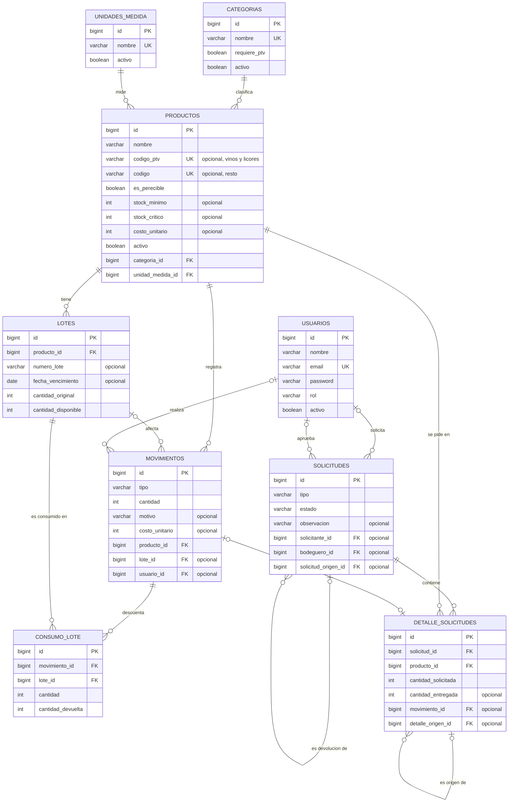
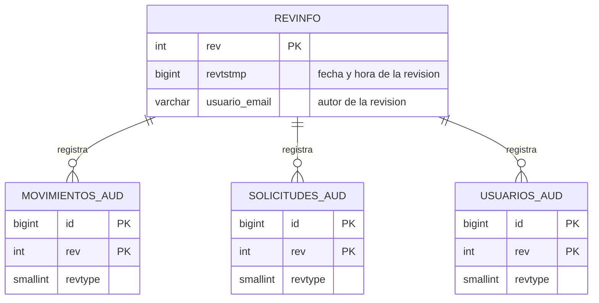

# Modelo de datos — Smart RDP

> Proyecto de Título PTY4614-002D · Equipo 3 · Duoc UC, Sede San Bernardo
> Versión: borrador para revisión · 12-10-2026

## 1. Propósito y fuente

Este documento describe el modelo de datos relacional de Smart RDP: el diagrama entidad-relación, el diccionario de datos de cada tabla y las reglas de integridad.

**Fuente.** Se obtuvo del esquema real de la base de desarrollo (PostgreSQL 18, base `smartrdp`) y se contrastó con las entidades JPA del backend (`backend/src/main/java/com/smartrdp/backend`). Las tablas las crea y actualiza Hibernate (`spring.jpa.hibernate.ddl-auto=update`); las restricciones `CHECK` de los valores permitidos las mantiene la clase `MigracionesIniciales`.

**Cómo leer el diagrama.** La notación es de pata de gallo (crow's foot): `||` exactamente uno, `|o` cero o uno, `o{` cero o muchos, `|{` uno o muchos. Una línea continua indica que la fila hija depende de la madre; una discontinua, una relación opcional. Para no recargar el diagrama se omiten las columnas comunes `created_at` y `updated_at` (ver sección 3).

## 2. Diagrama entidad-relación

### 2.1 Tablas de auditoría

Hibernate Envers crea una tabla de auditoría para tres entidades. Cada una copia las columnas auditadas de su tabla y agrega `rev` y `revtype`. La tabla `revinfo` guarda quién y cuándo hizo cada revisión.

## 3. Diccionario de datos

### 3.1 Columnas comunes

Todas las tablas de negocio (no las de auditoría) heredan de `BaseEntity` estas tres columnas:

| Columna | Tipo | ¿Nulo? | Descripción |
|---|---|---|---|
| `id` | bigint | No | Clave primaria generada por la base. |
| `created_at` | timestamp | No | Fecha y hora de creación de la fila. |
| `updated_at` | timestamp | No | Fecha y hora de la última modificación. |

### 3.2 `categorias`

Categorías de productos (por ejemplo Vinos, Licores, Abarrotes, Lácteos).

| Columna | Tipo | ¿Nulo? | Restricciones | Descripción |
|---|---|---|---|---|
| `nombre` | varchar(50) | No | Único | Nombre de la categoría. |
| `requiere_ptv` | boolean | No | Por defecto `false` | Si es `true`, los productos de la categoría se identifican con código PTV; si no, con código numérico. |
| `activo` | boolean | No | | Borrado lógico: `false` = deshabilitada. |

### 3.3 `unidades_medida`

| Columna | Tipo | ¿Nulo? | Restricciones | Descripción |
|---|---|---|---|---|
| `nombre` | varchar(50) | No | Único | Nombre de la unidad (por ejemplo Unidad, Botella, Kg, Litro). |
| `activo` | boolean | No | | Borrado lógico. |

### 3.4 `productos`

| Columna | Tipo | ¿Nulo? | Restricciones | Descripción |
|---|---|---|---|---|
| `nombre` | varchar(150) | No | | Nombre del producto. |
| `codigo_ptv` | varchar(20) | Sí | Único | Código SAP (PTV), alfanumérico y en mayúsculas. Se usa en categorías con `requiere_ptv`. |
| `codigo` | varchar(20) | Sí | Único | Código numérico. Se usa en las demás categorías. |
| `es_perecible` | boolean | No | | Si es `true`, sus entradas exigen fecha de vencimiento y se controlan por lotes FEFO. |
| `stock_minimo` | integer | Sí | | Umbral bajo el cual el estado de stock pasa a BAJO. |
| `stock_critico` | integer | Sí | | Umbral bajo el cual el estado de stock pasa a CRITICO. |
| `costo_unitario` | integer | Sí | | Costo unitario en pesos, usado para valorizar el stock. |
| `activo` | boolean | No | | Borrado lógico: `false` = deshabilitado; conserva su historial. |
| `categoria_id` | bigint | No | FK → `categorias.id` | Categoría del producto. |
| `unidad_medida_id` | bigint | No | FK → `unidades_medida.id` | Unidad de medida. |

### 3.5 `lotes`

Partidas de un producto que ingresan juntas y comparten fecha de vencimiento.

| Columna | Tipo | ¿Nulo? | Restricciones | Descripción |
|---|---|---|---|---|
| `producto_id` | bigint | No | FK → `productos.id` | Producto al que pertenece. |
| `numero_lote` | varchar(50) | Sí | | Identificador del lote, si el proveedor lo informa. |
| `fecha_vencimiento` | date | Sí | | Vencimiento. Vacía en productos no perecibles. |
| `cantidad_original` | integer | No | | Cantidad con que ingresó el lote. |
| `cantidad_disponible` | integer | No | | Cantidad que aún queda en el lote. |

### 3.6 `movimientos`

Libro de entradas y salidas de bodega.

| Columna | Tipo | ¿Nulo? | Restricciones | Descripción |
|---|---|---|---|---|
| `tipo` | varchar(10) | No | `CHECK` en `ENTRADA`, `SALIDA`, `SOLICITADO`, `DEVOLUCION` | Tipo de movimiento (ver sección 5). |
| `cantidad` | integer | No | | Unidades del movimiento. |
| `motivo` | varchar(200) | Sí | | Motivo o referencia (por ejemplo «Solicitud #12 de Ana»). |
| `costo_unitario` | integer | Sí | | Costo unitario del producto al momento del movimiento (copia histórica). |
| `producto_id` | bigint | No | FK → `productos.id` | Producto movido. |
| `lote_id` | bigint | Sí | FK → `lotes.id` | Lote asociado: en una entrada, el lote creado; en una salida que usa varios lotes, el último usado. El detalle completo está en `consumo_lote`. |
| `usuario_id` | bigint | Sí | FK → `usuarios.id` | Usuario que realizó el movimiento. |

### 3.7 `consumo_lote`

Detalle de cuánto sacó un movimiento de cada lote. Permite que una devolución regrese el producto a los mismos lotes y con los mismos vencimientos.

| Columna | Tipo | ¿Nulo? | Restricciones | Descripción |
|---|---|---|---|---|
| `movimiento_id` | bigint | No | FK → `movimientos.id` | Movimiento de salida o solicitado. |
| `lote_id` | bigint | No | FK → `lotes.id` | Lote del que se descontó. |
| `cantidad` | integer | No | | Unidades descontadas de ese lote. |
| `cantidad_devuelta` | integer | No | Por defecto `0` | Unidades de esa cantidad que ya fueron devueltas. |

### 3.8 `solicitudes`

Pedidos de insumos y devoluciones de los empleados.

| Columna | Tipo | ¿Nulo? | Restricciones | Descripción |
|---|---|---|---|---|
| `tipo` | varchar(10) | No | `CHECK` en `PEDIDO`, `DEVOLUCION`; por defecto `PEDIDO` | Si pide insumos o devuelve productos. |
| `estado` | varchar(15) | No | `CHECK` en `PENDIENTE`, `APROBADA`, `RECHAZADA` | Estado del trámite. |
| `observacion` | varchar(300) | Sí | | Comentario libre. |
| `solicitante_id` | bigint | Sí | FK → `usuarios.id` | Empleado que hizo la solicitud. |
| `bodeguero_id` | bigint | Sí | FK → `usuarios.id` | Bodeguero que la aprobó o rechazó. |
| `solicitud_origen_id` | bigint | Sí | FK → `solicitudes.id` | En una devolución, el pedido del que se devuelve. |

### 3.9 `detalle_solicitudes`

Líneas de cada solicitud.

| Columna | Tipo | ¿Nulo? | Restricciones | Descripción |
|---|---|---|---|---|
| `solicitud_id` | bigint | No | FK → `solicitudes.id` | Solicitud a la que pertenece. |
| `producto_id` | bigint | No | FK → `productos.id` | Producto pedido o devuelto. |
| `cantidad_solicitada` | integer | No | | Cantidad pedida (o que se quiere devolver). |
| `cantidad_entregada` | integer | Sí | | Cantidad realmente entregada o aceptada; vacía hasta que el bodeguero aprueba. |
| `movimiento_id` | bigint | Sí | FK → `movimientos.id` | Movimiento generado al aprobar. |
| `detalle_origen_id` | bigint | Sí | FK → `detalle_solicitudes.id` | En una devolución, la línea del pedido de la que se devuelve. |

### 3.10 `usuarios`

| Columna | Tipo | ¿Nulo? | Restricciones | Descripción |
|---|---|---|---|---|
| `nombre` | varchar(100) | No | | Nombre del usuario; es el que se muestra en la vista pública del empleado. |
| `email` | varchar(150) | No | Único | Correo, identidad del usuario en la auditoría. |
| `password` | varchar(255) | No | | Contraseña como hash BCrypt, nunca en texto plano. |
| `rol` | varchar(20) | No | `CHECK` en `ADMIN`, `BODEGUERO`, `EMPLEADO` | Rol del usuario. |
| `activo` | boolean | No | | Borrado lógico: un usuario inactivo no puede ingresar ni aparece en la vista pública. |

### 3.11 Tablas de auditoría (Envers)

| Tabla | Columnas | Descripción |
|---|---|---|
| `revinfo` | `rev` (PK), `revtstmp`, `usuario_email` | Una fila por revisión: número, fecha y hora (en milisegundos) y correo del autor. |
| `movimientos_aud` | `id`, `rev`, `revtype`, `cantidad`, `motivo`, `tipo`, `producto_id`, `costo_unitario` | Historial de cada movimiento. |
| `solicitudes_aud` | `id`, `rev`, `revtype`, `estado`, `observacion`, `bodeguero_id`, `solicitante_id`, `tipo`, `solicitud_origen_id` | Historial de cada solicitud. |
| `usuarios_aud` | `id`, `rev`, `revtype`, `activo`, `email`, `nombre`, `rol` | Historial de cada usuario. **No tiene columna de contraseña.** |

En las tablas `_aud`, `rev` es clave foránea de `revinfo.rev` y `revtype` indica el tipo de cambio (0 alta, 1 modificación, 2 baja). La clave primaria es (`id`, `rev`).

## 4. Reglas de integridad

Las reglas que no son una restricción de la base las valida el backend.

| Regla | Dónde se aplica |
|---|---|
| Un producto tiene **exactamente uno** de los dos códigos: `codigo_ptv` si su categoría tiene `requiere_ptv`, `codigo` en las demás. El PTV es alfanumérico y se guarda en mayúsculas; el código es numérico. | Backend (`ProductoService`); la unicidad de cada código la garantiza la base. |
| El correo de un usuario es único sin distinguir mayúsculas. | Base (único) y backend. |
| El nombre de un empleado **activo** es único sin distinguir mayúsculas, porque la vista pública lista a los empleados por nombre. | Backend (`UsuarioAdminService`). |
| El stock de un producto es la suma de `cantidad_disponible` de sus lotes. Las entradas y devoluciones suman; las salidas y los solicitados restan. | Backend (`MovimientoService`). |
| Las salidas descuentan de los lotes por FEFO: primero el que vence antes. | Backend (`MovimientoService`). |
| En un pedido, lo entregado no puede superar lo solicitado; en una devolución, no puede superar lo entregado menos lo ya devuelto. | Backend (`SolicitudService`). |
| No se borran productos, categorías, unidades de medida ni usuarios: se desactivan con `activo = false`, para conservar el historial. | Backend. |
| Los valores permitidos de `tipo`, `estado` y `rol` los restringe la base con `CHECK`. | Base (`MigracionesIniciales`). |

## 5. Valores permitidos

| Columna | Valor | Significado |
|---|---|---|
| `movimientos.tipo` | `ENTRADA` | Ingreso de stock; suma. |
| | `SALIDA` | Salida directa registrada por el bodeguero; resta. |
| | `SOLICITADO` | Salida generada al aprobar un pedido de un empleado; resta. |
| | `DEVOLUCION` | Reintegro a bodega al aprobar una devolución; suma. |
| `solicitudes.tipo` | `PEDIDO` | Pide insumos. |
| | `DEVOLUCION` | Devuelve productos de un pedido ya entregado. |
| `solicitudes.estado` | `PENDIENTE` | Esperando al bodeguero. |
| | `APROBADA` | Aprobada; ya generó movimientos. |
| | `RECHAZADA` | Rechazada; no afecta el stock. |
| `usuarios.rol` | `ADMIN` | Administrador: Analítica y Usuarios. |
| | `BODEGUERO` | Bodeguero: inventario, movimientos, solicitudes, mantenedores y Analítica. |
| | `EMPLEADO` | Empleado: usa la vista pública; no inicia sesión. |

El estado de stock (`NORMAL`, `BAJO`, `CRITICO`, `AGOTADO`) no se guarda: se calcula a partir del stock y de los umbrales `stock_minimo` y `stock_critico` del producto.

## 6. Referencias

- Documentación de Mermaid: [Entity Relationship Diagrams](https://mermaid.js.org/syntax/entityRelationshipDiagram.html).
- GitHub Docs: [Creating diagrams](https://docs.github.com/en/get-started/writing-on-github/working-with-advanced-formatting/creating-diagrams).
