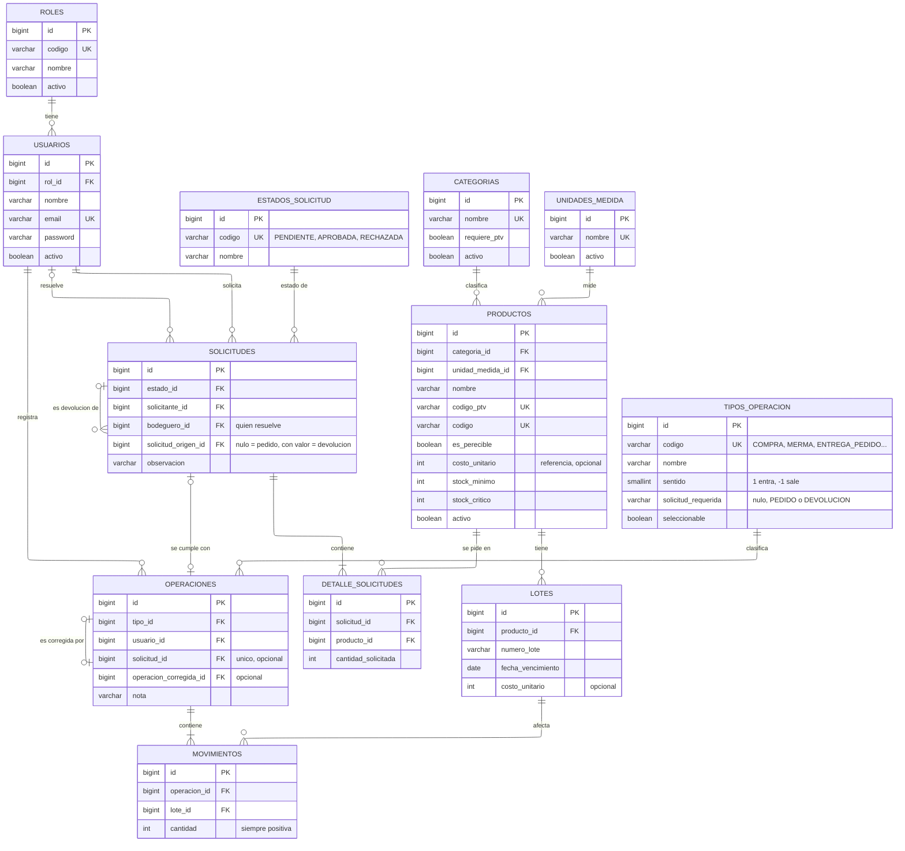
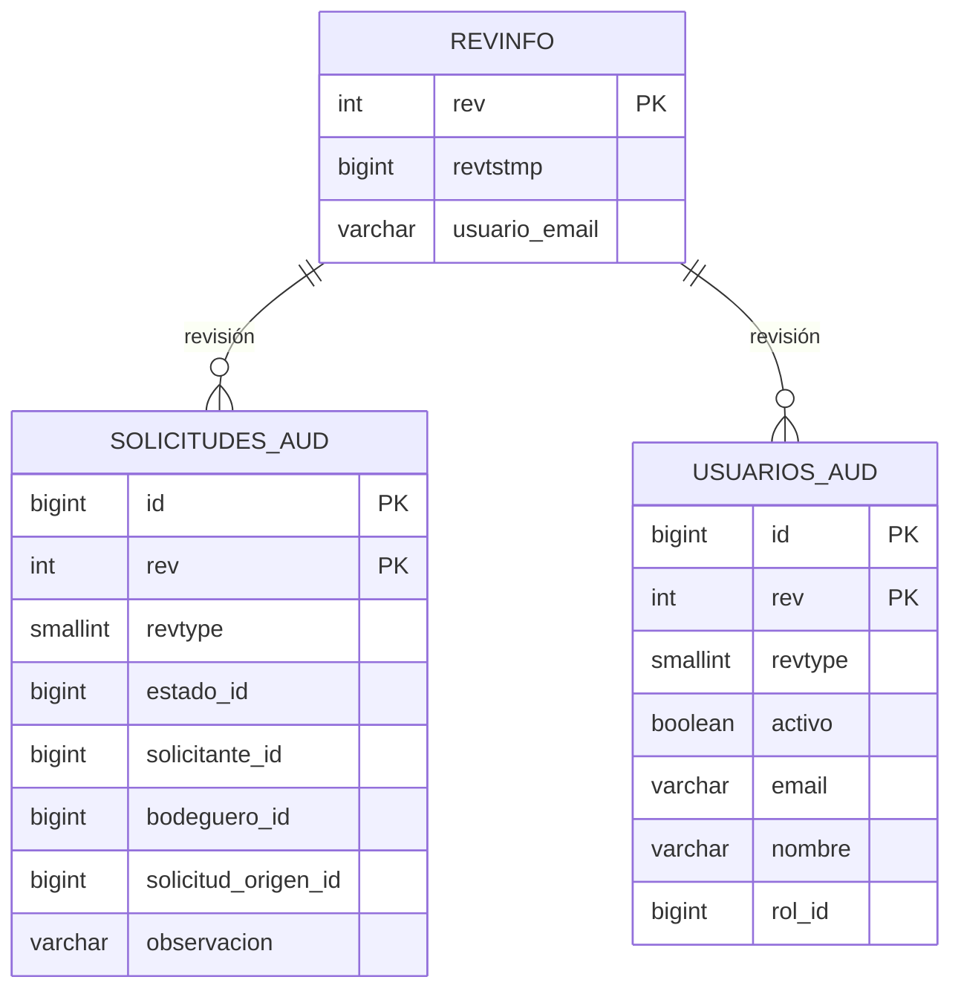

# Modelo de datos — Smart RDP

> Proyecto de Título PTY4614-002D · Equipo 3 · Duoc UC, Sede San Bernardo
> Versión: modelo vigente: libro de operaciones y movimientos · 08-11-2026

> **Nota.** Las imágenes `.png` de esta carpeta (entidad-relación, clases, secuencia y tablas de auditoría) corresponden al modelo anterior y están desactualizadas; los diagramas vigentes son los bloques Mermaid de este documento. Hay que regenerar los PNG a partir de ellos antes de entregarlos.

## 1. Propósito y fuente

Este documento describe el modelo de datos relacional de Smart RDP: el diagrama entidad-relación, el diccionario de datos de cada tabla y las reglas de integridad.

**Fuente.** El esquema se define en `backend/src/main/resources/db/migration/V1__esquema.sql` (migración de Flyway) y se contrastó con la base de desarrollo (PostgreSQL 18, base `smartrdp`) y con las entidades JPA del backend (`backend/src/main/java/com/smartrdp/backend`). Hibernate solo **valida** que las entidades coincidan con ese esquema (`spring.jpa.hibernate.ddl-auto=validate`); no crea ni modifica tablas. Las reglas de integridad que cruzan tablas las garantizan triggers de PostgreSQL definidos en la misma migración.

**Cómo leer el diagrama.** La notación es de pata de gallo (crow's foot): `||` exactamente uno, `|o` cero o uno, `o{` cero o muchos, `|{` uno o muchos. Para no recargar el diagrama se omiten las columnas comunes `created_at` y `updated_at` (ver sección 3). El stock no es una columna de ninguna tabla: se calcula con vistas a partir del libro de operaciones y movimientos (ver 3.14).

## 2. Diagrama entidad-relación

### 2.1 Tablas de auditoría

Hibernate Envers guarda el historial de **solicitudes** y **usuarios**. El libro de operaciones y movimientos no necesita Envers: es inmutable por diseño (triggers), así que ya es su propio historial.

## 3. Diccionario de datos

### 3.1 Columnas comunes

Todas las tablas de negocio (no las de auditoría) heredan de `BaseEntity` estas tres columnas:

| Columna | Tipo | ¿Nulo? | Descripción |
|---|---|---|---|
| `id` | bigint | No | Clave primaria generada por la base. |
| `created_at` | timestamp | No | Fecha y hora de creación de la fila. |
| `updated_at` | timestamp | No | Fecha y hora de la última modificación. |

### 3.2 `roles`

| Columna | Tipo | ¿Nulo? | Descripción |
|---|---|---|---|
| `codigo` | character varying(20) | No | Código estable que usa el backend (`ADMIN`, `BODEGUERO`, `EMPLEADO`). |
| `nombre` | character varying(50) | No | Nombre para mostrar. |
| `activo` | boolean | No | `false` si el rol deja de usarse. |

### 3.3 `estados_solicitud`

| Columna | Tipo | ¿Nulo? | Descripción |
|---|---|---|---|
| `codigo` | character varying(20) | No | Código estable (`PENDIENTE`, `APROBADA`, `RECHAZADA`). |
| `nombre` | character varying(50) | No | Nombre para mostrar. |

### 3.4 `tipos_operacion`

| Columna | Tipo | ¿Nulo? | Descripción |
|---|---|---|---|
| `codigo` | character varying(30) | No | Código estable del tipo (p. ej. `COMPRA`, `MERMA`, `ENTREGA_PEDIDO`). |
| `nombre` | character varying(60) | No | Nombre para mostrar. |
| `sentido` | smallint | No | `1` si la operación suma stock, `-1` si lo resta. El signo de cada movimiento sale de aquí. |
| `solicitud_requerida` | character varying(10) | Sí | `PEDIDO` o `DEVOLUCION` si la operación solo puede nacer de una solicitud de ese tipo; nulo si es manual. |
| `seleccionable` | boolean | No | `true` si el bodeguero puede elegirlo al registrar a mano; los que nacen de una solicitud o de una corrección son `false`. |

### 3.5 `categorias`

| Columna | Tipo | ¿Nulo? | Descripción |
|---|---|---|---|
| `nombre` | character varying(50) | No | Nombre único de la categoría. |
| `activo` | boolean | No | `false` si la categoría se desactivó (no se borra). |
| `requiere_ptv` | boolean | No | `true` si los productos de la categoría se identifican con código PTV (vinos y licores). |

### 3.6 `unidades_medida`

| Columna | Tipo | ¿Nulo? | Descripción |
|---|---|---|---|
| `nombre` | character varying(50) | No | Nombre único de la unidad (kg, litro, unidad…). |
| `activo` | boolean | No | `false` si la unidad se desactivó. |

### 3.7 `usuarios`

| Columna | Tipo | ¿Nulo? | Descripción |
|---|---|---|---|
| `rol_id` | bigint | No | Rol del usuario (`roles`). Clave foránea a `roles.id`. |
| `nombre` | character varying(100) | No | Nombre completo. |
| `email` | character varying(150) | No | Correo único (la base lo exige único y el backend lo compara sin distinguir mayúsculas). |
| `password` | character varying(255) | No | Hash BCrypt de la contraseña. |
| `activo` | boolean | No | `false` si el usuario se desactivó (no se borra). |

### 3.8 `productos`

| Columna | Tipo | ¿Nulo? | Descripción |
|---|---|---|---|
| `categoria_id` | bigint | No | Categoría del producto. Clave foránea a `categorias.id`. |
| `unidad_medida_id` | bigint | No | Unidad en la que se cuenta el producto. Clave foránea a `unidades_medida.id`. |
| `nombre` | character varying(150) | No | Nombre del producto. |
| `codigo_ptv` | character varying(20) | Sí | Código PTV (vinos y licores); único. |
| `codigo` | character varying(20) | Sí | Código interno del resto de los productos; único. |
| `es_perecible` | boolean | No | `true` si sus lotes deben informar fecha de vencimiento. |
| `stock_minimo` | integer | No | Umbral bajo el cual el estado de stock pasa a `BAJO`. |
| `stock_critico` | integer | No | Umbral bajo el cual pasa a `CRITICO`; no puede superar al mínimo. |
| `costo_unitario` | integer | Sí | Costo de referencia en pesos: se sugiere al ingresar un lote. La valorización usa el costo del lote. |
| `activo` | boolean | No | `false` si el producto se desactivó (no se borra). |

### 3.9 `lotes`

| Columna | Tipo | ¿Nulo? | Descripción |
|---|---|---|---|
| `producto_id` | bigint | No | Producto al que pertenece la tanda. Clave foránea a `productos.id`. |
| `numero_lote` | character varying(50) | Sí | Número de lote del proveedor, si lo hay. |
| `fecha_vencimiento` | date | Sí | Fecha de vencimiento; nula en productos no perecibles. El FEFO descuenta primero el que vence antes. |
| `costo_unitario` | integer | Sí | Costo en pesos de esta tanda; nulo si se desconoce. Un lote no se modifica después de creado. |

### 3.10 `solicitudes`

| Columna | Tipo | ¿Nulo? | Descripción |
|---|---|---|---|
| `estado_id` | bigint | No | Estado de la solicitud (`estados_solicitud`). Clave foránea a `estados_solicitud.id`. |
| `solicitante_id` | bigint | No | Empleado que la hizo. Clave foránea a `usuarios.id`. |
| `bodeguero_id` | bigint | Sí | Quien la resolvió; nulo mientras está pendiente. Clave foránea a `usuarios.id`. |
| `solicitud_origen_id` | bigint | Sí | Nulo = es un pedido; con valor = es una devolución de ese pedido. Clave foránea a `solicitudes.id`. |
| `observacion` | character varying(300) | Sí | Texto libre opcional. |

### 3.11 `detalle_solicitudes`

| Columna | Tipo | ¿Nulo? | Descripción |
|---|---|---|---|
| `solicitud_id` | bigint | No | Solicitud a la que pertenece la línea. Clave foránea a `solicitudes.id`. |
| `producto_id` | bigint | No | Producto pedido o devuelto; único dentro de la solicitud. Clave foránea a `productos.id`. |
| `cantidad_solicitada` | integer | No | Cantidad pedida (o a devolver); mayor que cero. Lo entregado no se guarda aquí: se calcula del libro. |

### 3.12 `operaciones`

| Columna | Tipo | ¿Nulo? | Descripción |
|---|---|---|---|
| `tipo_id` | bigint | No | Tipo de operación (`tipos_operacion`). Clave foránea a `tipos_operacion.id`. |
| `usuario_id` | bigint | No | Quien movió el stock. Clave foránea a `usuarios.id`. |
| `solicitud_id` | bigint | Sí | Solicitud que cumple la operación; única, así una solicitud no se aprueba dos veces. Clave foránea a `solicitudes.id`. |
| `operacion_corregida_id` | bigint | Sí | Solo en correcciones: la operación que contrarresta; única, así una operación se corrige a lo más una vez. Clave foránea a `operaciones.id`. |
| `nota` | character varying(300) | Sí | Texto libre del registro. |

### 3.13 `movimientos`

| Columna | Tipo | ¿Nulo? | Descripción |
|---|---|---|---|
| `operacion_id` | bigint | No | Operación a la que pertenece la línea. Clave foránea a `operaciones.id`. |
| `lote_id` | bigint | No | Lote afectado. Clave foránea a `lotes.id`. |
| `cantidad` | integer | No | Cantidad siempre positiva; suma o resta según el sentido del tipo de la operación. |

### 3.14 Vistas de inventario

El stock **no se guarda**: se calcula con estas vistas, que son la única fuente de verdad.

- **`saldo_lote`** — Saldo de cada lote: entradas menos salidas del libro. Columnas: `lote_id`, `producto_id`, `fecha_vencimiento`, `costo_unitario`, `saldo`.
- **`stock_producto`** — Stock de cada producto (suma de saldos), su valor (saldo por costo de cada lote; nulo si ningún lote tiene costo) y su estado (`NORMAL`, `BAJO`, `CRITICO`, `AGOTADO`). El vencimiento más próximo no está aquí: se obtiene de `saldo_lote`. Columnas: `producto_id`, `stock`, `valor`, `estado`.
- **`solicitado_vs_entregado`** — Por solicitud y producto: lo solicitado, lo entregado y si es un agregado (entregado sin haber sido pedido). Columnas: `solicitud_id`, `producto_id`, `cantidad_solicitada`, `cantidad_entregada`, `agregado`.
- **`devolvible_lote`** — Por pedido y lote: cuánto se entregó, cuánto se devolvió y cuánto aún se puede devolver. Columnas: `pedido_id`, `lote_id`, `producto_id`, `movimiento_id`, `entregado`, `devuelto`, `devolvible`.

### 3.15 Tablas de auditoría (Envers)

`revinfo` guarda una fila por revisión (marca de tiempo y correo de quien la hizo); `solicitudes_aud` y `usuarios_aud` copian las columnas auditadas de la tabla de negocio más `rev` y `revtype` (0 alta, 1 modificación, 2 baja).

| Tabla | Columnas | Descripción |
|---|---|---|
| `revinfo` | `rev` (PK), `revtstmp`, `usuario_email` | Una fila por revisión: número, fecha y hora (en milisegundos) y correo del autor. |
| `solicitudes_aud` | `id`, `rev`, `revtype`, `estado_id`, `solicitante_id`, `bodeguero_id`, `solicitud_origen_id`, `observacion` | Historial de cada solicitud. |
| `usuarios_aud` | `id`, `rev`, `revtype`, `activo`, `email`, `nombre`, `rol_id` | Historial de cada usuario. **No tiene columna de contraseña.** |

En las tablas `_aud`, `rev` es clave foránea de `revinfo.rev` y la clave primaria es (`id`, `rev`).

## 4. Reglas de integridad

Criterio: lo que cabe en una fila lo garantiza la base con `CHECK`, `UNIQUE` o clave foránea; lo que cruza tablas o suma filas lo garantiza un trigger de PostgreSQL. El backend valida antes para dar mensajes claros, pero **no es la única defensa**.

| Regla | Dónde se aplica |
|---|---|
| Un producto tiene exactamente uno de los dos códigos: `codigo_ptv` si su categoría tiene `requiere_ptv`, `codigo` en las demás. | Backend (`ProductoService`); únicos en la base. |
| El correo de un usuario es único sin distinguir mayúsculas; el nombre de un empleado activo también (la vista pública los lista por nombre). | Base (único) y backend (`UsuarioAdminService`). |
| El libro es inmutable: no se modifica ni se borra una operación, un movimiento ni un lote; se corrige con una operación contraria (espejo exacto), a lo más una vez por operación. | Trigger `INM` y `uq_operaciones_corregida`. |
| Ningún lote queda con saldo negativo, aunque dos personas operen a la vez. | Trigger T1 (diferido) más bloqueo de lotes en el backend. |
| Lo devuelto de un producto en un pedido no supera lo entregado en él. | Trigger T2 (diferido). |
| Una operación respeta su tipo: las que nacen de una solicitud la exigen, de la clase correcta y aún pendiente; las manuales no llevan solicitud. | Trigger T3. |
| Una devolución solo repone en lotes que ese pedido consumió, y el pedido de origen debe estar aprobado. | Triggers T2 y T4. |
| Una solicitud está `APROBADA` si y solo si tiene su operación; no se aprueba dos veces. | Triggers T5a/T5b (diferidos) y `uq_operaciones_solicitud`. |
| Toda operación tiene al menos un movimiento, y todo lote nace con una entrada. | Triggers T6 y T7 (diferidos). |
| Una solicitud resuelta y su detalle no se modifican. | Trigger `INM`. |
| Las salidas descuentan por FEFO: primero el lote que vence antes. | Backend (`MovimientoService`). |
| En un pedido el bodeguero entrega, de cada producto solicitado, hasta lo que se pidió (o menos), y puede sumar otros productos que no se pidieron: esos son los «agregados». | Backend y vista `solicitado_vs_entregado`. |
| «Productos más usados» (Analítica) cuenta las salidas netas de devoluciones: por producto, lo que sale (sentido −1) menos lo devuelto (`DEVOLUCION`), sin correcciones ni operaciones corregidas; los productos con neto 0 no aparecen. | Backend (`AnaliticaService`). |
| No se borran productos, categorías, unidades ni usuarios: se desactivan con `activo = false`. | Backend. |

## 5. Valores permitidos

Los valores viven en tablas de catálogo (cargadas por la migración `V1`), no en `CHECK` de texto.

| Catálogo | Código | Significado |
|---|---|---|
| `roles` | `ADMIN` | Administrador: Analítica y Usuarios. |
| | `BODEGUERO` | Bodeguero: inventario, movimientos, solicitudes, mantenedores y Analítica. |
| | `EMPLEADO` | Empleado: usa la vista pública; no inicia sesión. |
| `estados_solicitud` | `PENDIENTE` | Esperando al bodeguero. |
| | `APROBADA` | Aprobada; ya tiene su operación. |
| | `RECHAZADA` | Rechazada; no afecta el stock. |
| `tipos_operacion` (suman) | `INVENTARIO_INICIAL`, `COMPRA`, `AJUSTE_ENTRADA` | Entradas manuales. |
| | `DEVOLUCION` | Reintegro al aprobar una devolución (nace de la solicitud). |
| | `CORRECCION_AUMENTA` | Corrige una salida manual. |
| `tipos_operacion` (restan) | `MERMA`, `VENCIMIENTO`, `CONSUMO_INTERNO`, `AJUSTE_SALIDA` | Salidas manuales. |
| | `ENTREGA_PEDIDO` | Salida al aprobar un pedido (nace de la solicitud). |
| | `CORRECCION_DISMINUYE` | Corrige una entrada manual. |

Una solicitud es un **pedido** si `solicitud_origen_id` es nulo y una **devolución** si apunta al pedido de origen. El estado de stock (`NORMAL`, `BAJO`, `CRITICO`, `AGOTADO`) no se guarda: lo calcula la vista `stock_producto` con los umbrales del producto.

## 6. Referencias

- Documentación de Mermaid: [Entity Relationship Diagrams](https://mermaid.js.org/syntax/entityRelationshipDiagram.html).
- GitHub Docs: [Creating diagrams](https://docs.github.com/en/get-started/writing-on-github/working-with-advanced-formatting/creating-diagrams).
