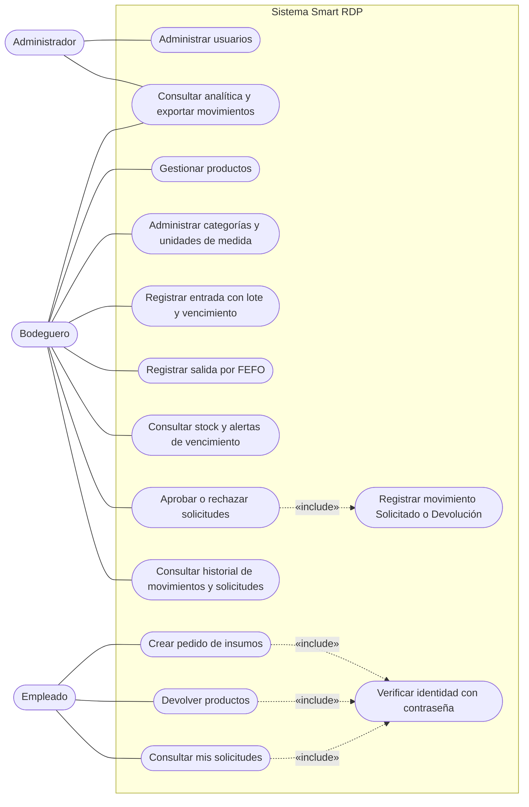
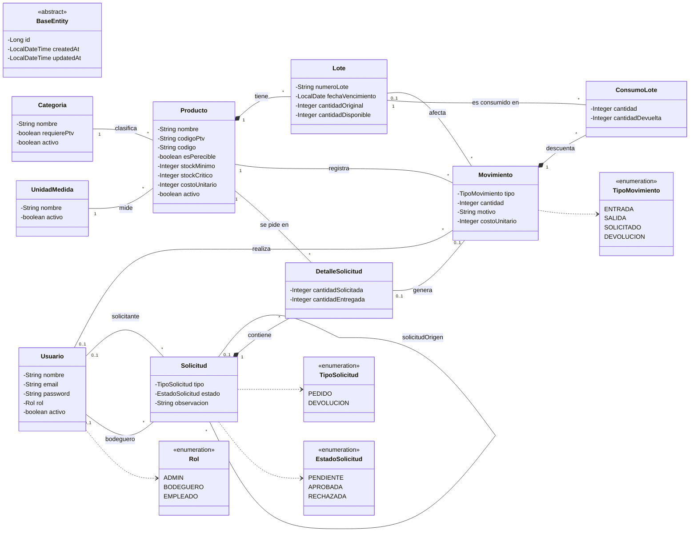
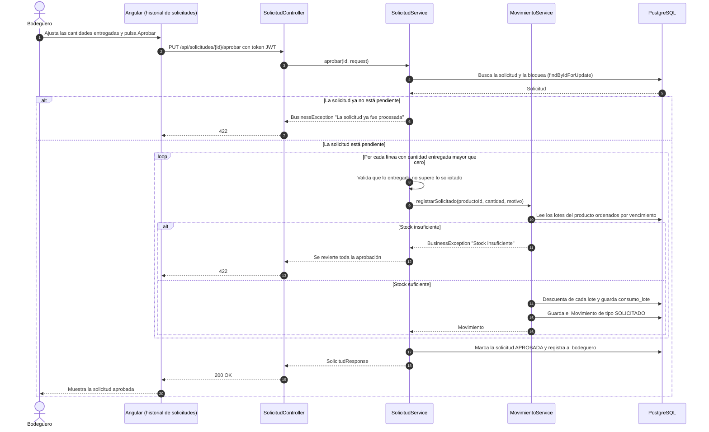
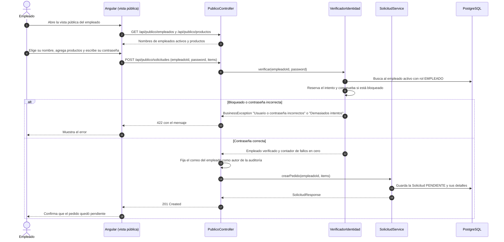
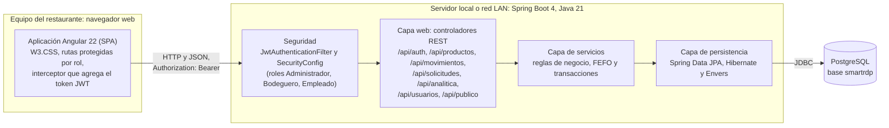

# Diagramas UML — Smart RDP

> Proyecto de Título PTY4614-002D · Equipo 3 · Duoc UC, Sede San Bernardo
> Versión: borrador para revisión · 12-10-2026

## 1. Alcance

El proyecto documenta cinco diagramas UML, suficientes para describir qué hace el sistema, cómo se estructura y cómo se ejecutan sus dos flujos principales. Cubren cuatro de los 14 tipos de diagrama de UML 2.5.1 (casos de uso, clases, secuencia y despliegue) y se complementan con el [modelo de datos](07-Modelo-de-Datos.md).

| N.º | Diagrama | Tipo UML | Qué muestra |
|---|---|---|---|
| 1 | Casos de uso | Comportamiento | Qué puede hacer cada rol. |
| 2 | Clases del dominio | Estructura | Entidades de negocio y sus relaciones. |
| 3 | Aprobar un pedido | Interacción (secuencia) | Cómo el bodeguero aprueba y se descuenta el stock por FEFO. |
| 4 | Pedido del empleado | Interacción (secuencia) | Cómo el empleado se identifica y crea un pedido. |
| 5 | Arquitectura y despliegue | Estructura (despliegue, dibujado como diagrama de flujo) | Componentes del sistema y dónde corren. |

Los diagramas están escritos en [Mermaid](https://mermaid.js.org), que GitHub dibuja directamente en el navegador. El diagrama de casos de uso se dibuja con la sintaxis de diagramas de flujo de Mermaid siguiendo la notación UML (actores, casos de uso, línea de asociación y relaciones `include`), porque la sintaxis nativa de casos de uso de Mermaid (`usecase-beta`) es reciente y puede no estar disponible en la versión que usa GitHub.

## 2. Diagrama de casos de uso

El **Administrador** ve Analítica y administra usuarios. El **Bodeguero** administra todo lo demás pero no a los usuarios y es el único que aprueba solicitudes. El **Empleado** no inicia sesión: usa la vista pública y se identifica con su nombre y su contraseña en cada acción.

## 3. Diagrama de clases del dominio

Las nueve entidades heredan de `BaseEntity` (`id`, `createdAt`, `updatedAt`). Solo `Movimiento`, `Solicitud` y `Usuario` tienen historial con Hibernate Envers.

## 4. Diagrama de secuencia: aprobar un pedido

El bodeguero revisa un pedido pendiente, ajusta si es necesario la cantidad que realmente entrega y lo aprueba. El sistema descuenta del stock por FEFO y deja un movimiento **Solicitado**. Toda la aprobación ocurre en una sola transacción: si falla un descuento, no queda nada a medias.

## 5. Diagrama de secuencia: pedido del empleado

El empleado no inicia sesión. Elige su nombre en una lista, escribe su contraseña y envía el pedido. El sistema verifica su identidad en cada acción y limita los intentos fallidos: tras cinco intentos incorrectos el empleado queda bloqueado cinco minutos.

## 6. Diagrama de arquitectura y despliegue

La arquitectura es **cliente-servidor**: una aplicación de una sola página (SPA) en Angular consume una API REST de Spring Boot, que persiste en PostgreSQL. El backend es un **monolito modular en capas** (controlador, servicio, repositorio) con un paquete por dominio: `producto`, `movimiento`, `solicitud`, `usuario`, `catalogo`, `analitica`, `auditoria`, `publico`. La seguridad es sin estado: el cliente envía un token JWT en cada petición y un filtro valida el rol antes de llegar al controlador.

### Patrón de arquitectura

| Aspecto | Decisión | Motivo |
|---|---|---|
| Estilo general | Cliente-servidor con SPA y API REST | Separa la interfaz de las reglas de negocio y deja el frontend reutilizable. |
| Organización del backend | Monolito modular en capas, un paquete por dominio | Es simple de desplegar en el restaurante y suficiente para un equipo de tres personas. |
| Seguridad | Autenticación con JWT sin estado y control de acceso por rol (RBAC) | El servidor no guarda sesiones y cada ruta declara qué roles la usan. |
| Persistencia | JPA con Hibernate sobre PostgreSQL; auditoría con Envers | Trazabilidad de quién cambió qué y cuándo, sin código manual en la lógica de negocio. |
| Despliegue | Local o en la red LAN del restaurante; PostgreSQL puede levantarse con `docker-compose.yml` | Corresponde a la restricción de conectividad local del proyecto. La decisión final de infraestructura sigue pendiente con el cliente. |

## 7. Referencias

- Object Management Group. (2017). *Unified Modeling Language (UML), versión 2.5.1*. https://www.omg.org/spec/UML/2.5.1
- Mermaid. [Sequence diagrams](https://mermaid.js.org/syntax/sequenceDiagram.html), [Class diagrams](https://mermaid.js.org/syntax/classDiagram.html) y [Flowcharts](https://mermaid.js.org/syntax/flowchart.html).
- GitHub Docs. [Creating diagrams](https://docs.github.com/en/get-started/writing-on-github/working-with-advanced-formatting/creating-diagrams).
